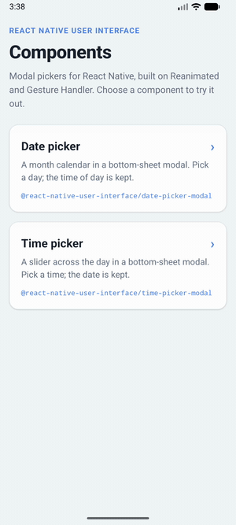

# @react-native-user-interface/time-picker-modal

A time picker for React Native that opens as a bottom-sheet modal. Drag the slider along the day, or step with the − and + buttons, then confirm.

<p align="center">
  
</p>

> :warning: This library is not yet recommended for production use. Use at your own risk.

- A slider runs across the day, marking every hour and half hour. It snaps to the nearest step and follows the speed of your swipe.
- The step size can be anything from 1 minute to 1 hour.
- Only the hours and minutes change: the date of the `Date` you pass in is kept. This means you can share one `Date` with [`<DatePickerModal />`](https://www.npmjs.com/package/@react-native-user-interface/date-picker-modal).
- The slider runs on the UI thread with Reanimated, so dragging stays smooth.
- Every part can be restyled through the `stylesheet` prop.
- Written in TypeScript, with types included.

## Requirements

- React Native 0.80 or later, with the New Architecture enabled (Reanimated 4 requires it).
- React 19.

## Installation

```sh
npm install @react-native-user-interface/time-picker-modal
# or
yarn add @react-native-user-interface/time-picker-modal
```

### Peer dependencies

| Package | Version |
| --- | --- |
| [date-fns](https://www.npmjs.com/package/date-fns) | 2.30+, 3 or 4 |
| [react](https://www.npmjs.com/package/react) | 19+ |
| [react-native](https://www.npmjs.com/package/react-native) | 0.80+ |
| [react-native-gesture-handler](https://www.npmjs.com/package/react-native-gesture-handler) | 2.16+ (2.x) |
| [react-native-reanimated](https://www.npmjs.com/package/react-native-reanimated) | 4.x |
| [react-native-safe-area-context](https://www.npmjs.com/package/react-native-safe-area-context) | 4.4.1+ |

```sh
npm install date-fns react-native-gesture-handler react-native-reanimated react-native-worklets react-native-safe-area-context
```

Reanimated 4 also needs [react-native-worklets](https://www.npmjs.com/package/react-native-worklets) and its Babel plugin. Add `react-native-worklets/plugin` as the **last** plugin in your Babel config. Pick the Reanimated and Worklets versions that match your React Native version; see the [Reanimated compatibility table](https://docs.swmansion.com/react-native-reanimated/docs/guides/compatibility).

### SVG support

The − and + icons are SVG files, so Metro needs to be able to import SVGs. We test with [react-native-svg](https://www.npmjs.com/package/react-native-svg) and [react-native-svg-transformer](https://www.npmjs.com/package/react-native-svg-transformer). They are not peer dependencies, so you can choose your own setup. Without one, Metro fails to bundle the package.

```sh
npm install react-native-svg
npm install --save-dev react-native-svg-transformer
```

```js
// metro.config.js
const { getDefaultConfig, mergeConfig } = require('@react-native/metro-config');

const defaultConfig = getDefaultConfig(__dirname);
const { assetExts, sourceExts } = defaultConfig.resolver;

module.exports = mergeConfig(defaultConfig, {
  transformer: {
    babelTransformerPath: require.resolve('react-native-svg-transformer'),
  },
  resolver: {
    assetExts: assetExts.filter((ext) => ext !== 'svg'),
    sourceExts: [...sourceExts, 'svg'],
  },
});
```

## Usage

Render your app inside a `SafeAreaProvider`, then control the modal with `visible`:

```tsx
import React, { useState } from 'react';
import { Button, Text, View } from 'react-native';
import { SafeAreaProvider } from 'react-native-safe-area-context';
import TimePickerModal from '@react-native-user-interface/time-picker-modal';

export const App = () => {
  const [datetime, setDatetime] = useState(() => new Date());
  const [visible, setVisible] = useState(false);

  return (
    <SafeAreaProvider>
      <View>
        <Text>{datetime.toLocaleTimeString()}</Text>
        <Button title="Change time" onPress={() => setVisible(true)} />
      </View>
      <TimePickerModal
        initialDatetime={datetime}
        onCancel={() => setVisible(false)}
        onConfirm={(selected) => {
          setDatetime(selected);
          setVisible(false);
        }}
        timeStep={15}
        visible={visible}
      />
    </SafeAreaProvider>
  );
};
```

The modal does not close itself: hide it in `onConfirm` and `onCancel`. Tapping outside the sheet calls `onCancel`.

## Props

| Prop | Type | Default | Description |
| --- | --- | --- | --- |
| `visible` | `boolean` | `false` | Whether the modal is shown. |
| `initialDatetime` | `Date` | now | The time selected when the picker opens. Its date is kept in the confirmed value. |
| `timeStep` | `TimeStep` | `5` | Minutes between selectable times: `1`, `2`, `3`, `4`, `5`, `10`, `15`, `20`, `30` or `60` (numbers or strings). |
| `onConfirm` | `(date: Date) => void` | | Called with the selected time when **Confirm** is pressed. Seconds and milliseconds are set to zero. |
| `onCancel` | `() => void` | | Called when **Cancel** is pressed or the backdrop is tapped. |
| `stylesheet` | `TimePickerModalStyleSheet` | `{}` | Style overrides, see below. |
| `animationType` | `'slide' \| 'fade' \| 'none'` | `'slide'` | Passed to React Native's `Modal`. |
| `presentationStyle` | `'overFullScreen' \| 'fullScreen' \| 'pageSheet' \| 'formSheet'` | `'overFullScreen'` | Passed to React Native's `Modal`. |
| `transparent` | `boolean` | `true` | Passed to React Native's `Modal`. |

## Styling

Pass a `stylesheet` to override any part of the default look. Each key is merged over the default style for that part.

```tsx
<TimePickerModal
  stylesheet={{
    confirmButton: { backgroundColor: '#111827' },
    timeSelectorBarSelectedSnapPoint: { backgroundColor: '#111827' },
    timeSelectorValue: { fontSize: 40 },
  }}
/>
```

| Key | Part |
| --- | --- |
| `container` | The full-screen backdrop. |
| `content` | The sheet. |
| `heading` | The "Select a Time" title. |
| `timeSelector` | The area holding the value and slider. |
| `timeSelectorControlsAndValueContainer`, `timeSelectorValue` | The − / + buttons and the selected time. |
| `timeSelectorBarContainer`, `timeSelectorBarIndexes` | The slider. |
| `timeSelectorBar` | Each step on the slider. |
| `timeSelectorBarHour`, `timeSelectorBarHalfHour` | Hour and half-hour marks. |
| `timeSelectorBarText` | The hour labels. |
| `timeSelectorBarSelectedSnapPoint` | The selected step. |
| `selectedTimeBoundaryIndexErrorContainer`, `selectedDateErrorText` | The "You need to select a time" message. |
| `confirmButton`, `confirmButtonText` | The **Confirm** button. |
| `cancelButton`, `cancelButtonText` | The **Cancel** button. |

## TypeScript

```ts
import type { TimePickerModalProps, TimePickerModalStyleSheet, TimeStep } from '@react-native-user-interface/time-picker-modal';
```

## License

MIT
